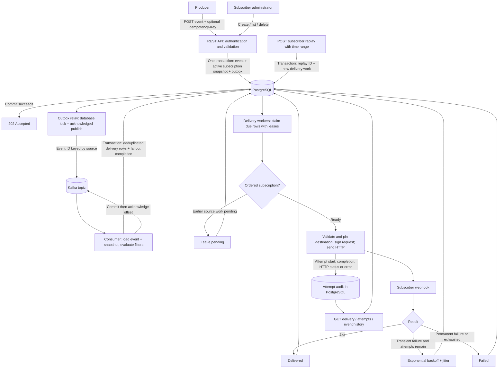

# Event-driven notification fanout

A Java 21 service that accepts JSON events, snapshots active subscriptions, routes events through Kafka, and sends signed webhook notifications. PostgreSQL is the source of truth for events, the transactional outbox, delivery state, and attempt history. Kafka is the asynchronous fanout backbone.

Implemented extensions: Kafka integration, opt-in per-source delivery ordering, an idempotent time-range replay API, and DigitalOcean deployment configuration. **No cloud resources have been provisioned or deployed by this repository.**

## Start locally

Requirements: Docker with Compose. Running outside Docker also requires JDK 21+; the Maven wrapper downloads Maven automatically.

```sh
cp .env.example .env
# Edit .env and replace FANOUT_API_KEY with `openssl rand -hex 32` output.
docker compose up --build -d
docker compose logs -f app
```

The API listens on `http://localhost:8080`. PostgreSQL and Kafka have persistent Docker volumes. `docker compose down` preserves them; `docker compose down -v` destroys all local data.

To run Java directly:

```sh
docker compose up -d postgres kafka kafka-init
export FANOUT_API_KEY='replace-with-a-random-value-at-least-32-characters-long'
export DB_URL='jdbc:postgresql://localhost:5432/fanout'
export DB_USERNAME=fanout
export DB_PASSWORD=fanout-local-only
export KAFKA_BOOTSTRAP_SERVERS=localhost:9092
./mvnw spring-boot:run
```

The Compose defaults are for local development. Kafka is a single plaintext broker, and PostgreSQL has a development password. Production uses managed PostgreSQL and Kafka with verified TLS; see [DigitalOcean deployment](deploy/digitalocean/README.md).

## Architecture



1. Ingestion commits an event, a snapshot of currently active subscription IDs, and an outbox row together. A successful `202` is returned only after commit. A database failure is an error, never a successful acceptance.
2. The relay publishes the event ID to Kafka with acknowledged writes. It marks the outbox row published only after Kafka confirms. A crash in between can publish a duplicate.
3. The Kafka consumer evaluates immutable filters from the ingestion snapshot. A transaction inserts delivery work and records fanout completion. Redelivery of a Kafka record cannot create another original delivery for the same event/subscription pair. The relay also republishes acknowledged events still awaiting fanout after five minutes, recovering from broker retention expiry or lost Kafka records using PostgreSQL.
4. Delivery workers claim due work using database leases. HTTP takes place outside a database transaction. Audit rows record attempts, including interrupted attempts whose outcome cannot be known after a crash.
5. Failed transient requests are scheduled in PostgreSQL. Retrying does not sleep in a Kafka consumer or depend on an in-memory timer surviving a restart.

Subscription deletion is a soft delete: it prevents membership in future ingestion snapshots and new replays. Already accepted events retain their subscription snapshot and delivery work. It does not retract HTTP requests or erase audit history.

## REST API

All `/api/v1/**` endpoints and protected observability endpoints require `X-API-Key`. This is an administrator API: the key grants access to all subscriptions and events. It is not a multi-tenant authorization system.

The complete request/response contract is available in [the OpenAPI specification](docs/openapi.yaml).

Request bodies are limited to 1 MiB by default, including chunked requests; compressed bodies are rejected. JSON is limited to 100 nesting levels, 100-character numeric tokens, and 1 MiB strings. Unknown DTO fields, duplicate keys, and trailing JSON tokens return `400`; oversized bodies return `413`. Payload objects, arrays, and scalar JSON values are supported within these limits.

```sh
export API=http://localhost:8080
export FANOUT_API_KEY='the-same-key-as-the-service'
```

| Method | Path | Purpose |
|---|---|---|
| `POST` | `/api/v1/subscriptions` | Create an immutable subscription, `201` |
| `GET` | `/api/v1/subscriptions` | List active subscriptions |
| `GET` | `/api/v1/subscriptions/{id}` | Inspect a subscription |
| `DELETE` | `/api/v1/subscriptions/{id}` | Soft-delete, `204` |
| `POST` | `/api/v1/events` | Durably accept an event, `202` |
| `GET` | `/api/v1/events/{id}` | Inspect event and fanout state |
| `GET` | `/api/v1/deliveries?eventId={id}` | Delivery history for an event |
| `GET` | `/api/v1/deliveries?subscriptionId={id}` | Delivery history for a subscription |
| `GET` | `/api/v1/deliveries/{id}` | Inspect one delivery |
| `GET` | `/api/v1/deliveries/{id}/attempts` | Timestamped attempt history |
| `POST` | `/api/v1/subscriptions/{id}/replays` | Schedule a time-range replay, `202` |
| `GET` | `/actuator/health` | Public health status |
| `GET` | `/actuator/health/liveness` | Process liveness |
| `GET` | `/actuator/health/readiness` | Readiness |
| `GET` | `/actuator/prometheus` | Authenticated Prometheus metrics |

List endpoints return JSON arrays and accept a bounded `limit` and an `after` cursor. For subscriptions and deliveries, pass the last item's numeric `sequence` as `after`; for attempts, pass its numeric `id`. UUID identifiers are not cursors. Delivery list filters can be combined. Audit entries contain attempt start/completion timestamps, the HTTP response status when received, and an error or outcome; an unknown network outcome has no fabricated HTTP status.

### Register a subscription

```sh
curl -i "$API/api/v1/subscriptions" \
  -H "X-API-Key: $FANOUT_API_KEY" \
  -H 'Content-Type: application/json' \
  -d '{
    "webhookUrl": "https://your-public-service.example/webhooks/orders",
    "signingSecret": "replace-this-with-a-random-32-byte-or-longer-secret",
    "ordered": true,
    "filter": {
      "eventTypes": ["order.created"],
      "sources": ["checkout"],
      "conditions": [
        {"path": "/total", "operator": "GTE", "value": 100},
        {"path": "/customer/country", "operator": "IN", "value": ["IN", "US"]}
      ]
    }
  }'
```

The URL must be HTTPS and resolve only to public addresses by default. For intentional local webhook testing, set `FANOUT_DELIVERY_ALLOW_HTTP=true` and `FANOUT_DELIVERY_ALLOW_PRIVATE_ADDRESSES=true`. Do not enable those exceptions for an internet-facing installation.

### Accept an event

```sh
curl -i "$API/api/v1/events" \
  -H "X-API-Key: $FANOUT_API_KEY" \
  -H 'Content-Type: application/json' \
  -H 'Idempotency-Key: order-1001-created' \
  -d '{"type":"order.created","source":"checkout","payload":{"orderId":"1001","total":149.99,"customer":{"country":"IN"}}}'
```

The same idempotency key and semantically equivalent request return the original event. Reusing a key with different content returns `409`. Keys are scoped to the operation, retained with the data, and limited to 128 characters. Without a key, repeated HTTP calls intentionally create distinct events. An HTTP timeout can mean the transaction committed; retry with the same key.

### Inspect delivery history

```sh
curl "$API/api/v1/deliveries?eventId=EVENT_UUID&limit=100" \
  -H "X-API-Key: $FANOUT_API_KEY"
curl "$API/api/v1/deliveries/DELIVERY_UUID/attempts" \
  -H "X-API-Key: $FANOUT_API_KEY"
```

Delivery status is `PENDING`, `DELIVERED`, or `FAILED`. Pending work may be waiting for its scheduled retry time, another earlier event, or an active lease. The attempt history distinguishes these from successful delivery; a `202` ingestion response is not a webhook receipt.

## Filter rule syntax

All top-level constraints and payload conditions are combined with **AND**. Entries inside `eventTypes` or `sources` use **OR**. An omitted or empty type/source list matches all values. An empty filter matches every event in the subscription snapshot. Matching is case-sensitive; there are no wildcards, regular expressions, executable expressions, or implicit string-to-number conversions.

`path` is an RFC 6901 JSON Pointer evaluated relative to `payload`: `/customer/id`, `/items/0/sku`, `/a~1b` for a property named `a/b`, and `/x~0y` for `x~y`.

| Operator | Value | Semantics |
|---|---|---|
| `EQ` | JSON value | Equality of an existing payload value |
| `NE` | JSON value | Inequality of an existing value; missing paths do not match |
| `EXISTS` | Boolean | `true` requires the path, `false` requires its absence |
| `IN` | JSON array | Existing value equals one entry |
| `GT`, `GTE`, `LT`, `LTE` | JSON number | Numeric comparison; nonnumeric or missing fields do not match |

Explicit JSON `null` is a present value and differs from a missing property. Empty conditions match. Invalid pointers/operators, incompatible operator values, malformed JSON, unknown fields, and oversized requests are rejected at the API boundary.

Numbers must also expand to at most 100 decimal characters, preventing tiny exponent tokens from expanding into oversized stored JSON. Storage validation rejects U+0000, unpaired Unicode surrogates, and numbers outside PostgreSQL numeric bounds with `400`, before persistence. These are [PostgreSQL JSONB representation limits](https://www.postgresql.org/docs/17/datatype-json.html).

## Webhook contract and receiver responsibilities

The body is a JSON envelope containing the original event ID, type, source, payload, acceptance time, ingestion sequence (`eventSequence`), delivery ID, subscription ID, and replay ID when applicable. The same delivery keeps the same `X-Delivery-Id` on every retry. A replay is a new delivery with a new delivery ID and the original event ID.

Headers:

- `X-Event-Id`: original event identifier.
- `X-Delivery-Id`: delivery identifier; use this as the idempotency key at the receiver.
- `X-Delivery-Attempt`: attempt number.
- `X-Webhook-Timestamp`: current Unix timestamp in seconds.
- `X-Webhook-Signature`: `v1=` followed by hexadecimal HMAC-SHA256.

The signed bytes are `timestamp + "." + exact HTTP request body bytes`, using the subscription signing secret. Verify signatures with constant-time comparison and a limited timestamp tolerance; do not parse and reserialize the body before verification. Store the delivery ID atomically with your business side effect and return `2xx` only after durable acceptance. Signature timestamps can change on retry.

Redirects are not followed. Destination addresses are checked and pinned for each attempt to reduce SSRF and DNS rebinding exposure. Connection and response deadlines bound network work. Response bodies are not retained in the audit store, avoiding unbounded storage and accidental collection of subscriber data.

## Delivery guarantees and failure conditions

This is **at-least-once delivery with a finite retry policy**, not exactly once. More precisely, accepted matching events produce durable delivery work; attempts continue until an acknowledged `2xx`, a destination-policy rejection, or the configured attempt limit. There is no promise that an unreachable subscriber will eventually receive a notification. Exhausted work remains visibly `FAILED` and can be replayed.

| Failure | Behavior |
|---|---|
| Database unavailable during ingest | Request fails; no successful acceptance is returned |
| Process crashes after commit but before producer receives `202` | Event remains durable; producer retry with the same key returns the original |
| Kafka unavailable | Accepted events remain in the PostgreSQL outbox; publication resumes after recovery |
| Kafka expires or loses a published record before fanout | The relay republishes unprocessed events after five minutes from retained PostgreSQL data |
| Relay crashes after broker acknowledgment | Duplicate Kafka publication is possible; fanout is idempotent |
| Consumer crashes before fanout commit | Kafka record is processed again |
| Consumer crashes after fanout commit, before offset commit | Record repeats; uniqueness and transaction state prevent duplicate original deliveries |
| Worker crashes after subscriber accepts, before success is recorded | Lease expires and another attempt is made; subscriber can receive a duplicate |
| Timeout / connection failure / any non-`2xx`, including redirects | Retry with capped exponential backoff and jitter, until the attempt limit; `Retry-After` is bounded by the maximum backoff |
| Destination violates URL/address policy | Terminal `FAILED`; inspect configuration and use replay after remediation |
| Subscriber processes a request but returns an error | A retry can repeat the side effect unless the receiver deduplicates |
| PostgreSQL loses committed data, backups are unavailable, or an operator deletes data | Durability cannot be recovered by this application alone |

Default delivery settings: 8 attempts, 1 second initial backoff, 5 minute maximum backoff, 10 second request timeout, 60 second lease, and 8 concurrent sends. Configure these with `fanout.delivery.*` Spring properties; keep leases longer than the complete network timeout budget. Retry exhaustion is an explicit terminal state, never a silent drop.

### Per-source ordering

Set `ordered=true` on a subscription to serialize dispatch for each `(subscription, source)` stream. A later event waits behind earlier nonterminal matching work, including earlier events still awaiting fanout. Different sources and subscriptions can progress independently. Ordering uses durable ingestion sequence, not producer clocks or timestamps supplied in the payload.

An exhausted/policy-failed delivery is terminal and releases subsequent work; ordering is therefore not gapless successful delivery. Network timeouts and process crashes create ambiguous remote outcomes: an earlier request might complete at the receiver after its lease expires. Receivers must still deduplicate, and absolute remote completion order cannot be guaranteed by an HTTP sender alone. Replays are appended to the current queue, with original event sequence preserved within the replay; they intentionally revisit historical events rather than restoring the original timeline.

### Replay after an outage

```sh
curl -i "$API/api/v1/subscriptions/SUBSCRIPTION_UUID/replays" \
  -H "X-API-Key: $FANOUT_API_KEY" \
  -H 'Content-Type: application/json' \
  -H 'Idempotency-Key: recovery-2026-11-01' \
  -d '{"from":"2026-11-01T00:00:00Z","to":"2026-11-02T00:00:00Z"}'
```

Ranges are UTC instants with inclusive `from` and exclusive `to`, based on server acceptance time. A range may span at most 31 days and select at most 10,000 eligible events. Split larger recovery windows. Replay reevaluates the target subscription's immutable filter against retained events for which that subscription was present in the original ingestion snapshot. It does not expose events accepted before registration. The target must be active. Repeating the same key and range returns the existing replay; different content with the same key conflicts. Original audit history is preserved.

## Tests and CI/CD

```sh
./mvnw test        # Unit tests; does not require Docker
./mvnw verify      # Unit + integration tests; requires a working Docker daemon
```

Integration tests use **real PostgreSQL and Kafka** in Testcontainers and a local HTTP receiver. They must run rather than silently skip when Docker is missing. Unit tests cover filter semantics, URL policy, signature generation, and retry behavior. Integration tests exercise HTTP authentication and validation, concurrent idempotent ingestion, matching/nonmatching fanout, retries and audit history, terminal failure, deletion, replay, ordering, duplicate Kafka records, a paused-broker outage, transaction rollback on outbox failure, and lease recovery/fencing. See the test sources for executable scenarios and precise assertions.

`.github/workflows/ci.yml` runs `verify` on pushes and pull requests, publishes test reports, and builds the deployment image. The manual DigitalOcean workflow reruns verification before deploying an existing App Platform app. It requires a `production` GitHub environment and its `DIGITALOCEAN_ACCESS_TOKEN` secret; details are in the deployment guide.

## Operations

- Monitor ingestion error rate, unpublished outbox age/count, Kafka consumer lag, pending delivery age, retry rate, terminal failure count, HTTP latency, database pool saturation, and disk usage. A healthy process alone does not prove subscribers are receiving notifications.
- Alert on growing oldest pending/outbox age and newly failed deliveries. Consult attempt history to distinguish subscriber HTTP failures from transport errors and interrupted attempts.
- Protect and back up PostgreSQL with point-in-time recovery. Kafka retention must cover expected consumer downtime. PostgreSQL events/outbox remain the recovery source; do not delete them casually.
- Keep signing secrets and the API key out of logs, source control, and URLs. Use managed runtime secrets. Backups contain sensitive event payloads and signing material.
- Stop gracefully to allow running HTTP attempts to complete. On abrupt termination, leases expire and interrupted work is eligible for recovery.
- Use a reverse proxy or cloud ingress for HTTPS, request-rate limits, and request-size limits. Keep metrics accessible only to authenticated internal monitoring.

## What we sacrifice for simplicity vs. what we would harden next

| Current choice | Consequence | Next hardening step |
|---|---|---|
| One service owns API, relay, matcher, workers | Straightforward deployment; shared resource budget | Separate worker roles and autoscale using backlog age |
| PostgreSQL stores event bodies and per-event subscription snapshots | Clear deterministic subscription semantics; storage grows with event/subscription volume | Partition/archive history, explicit retention contracts, indexed routing, and staged fanout for very large subscriber populations |
| One serialized relay publication path | Simple ordering/recovery; limits publish throughput | Partitioned outbox ownership with per-source ordering and measured load tests |
| One administrator API key | Small authentication surface; no subscriber isolation | OIDC, tenant-scoped authorization, quotas, key rotation, audit of administrative changes |
| Signing secrets stored with subscriptions | Reliable retry and replay signing; database readers can access secrets | KMS envelope encryption and secret rotation with versioned signatures |
| Immutable subscriptions and soft deletion | Stable ingestion snapshots | Versioned updates, explicit cancellation semantics, retention-aware tombstone cleanup |
| Bounded retries and terminal failure | Predictable resource use; a long outage needs replay | Automated dead-letter workflows, operator redrive controls, per-subscriber circuit breakers and rate budgets |
| Basic JSON Pointer filters | Predictable, safe matching cost | A constrained validated DSL only if actual product requirements need it |
| Application-level URL checks | Defense against common SSRF targets | Egress proxy/firewall allowlists, DNS controls, and tenant-specific destination policies |
| No automatic audit/event deletion | Complete retained replay and audit history; unbounded growth | Time partitioning, retention jobs, payload minimization, archive/replay policy, restore drills |
| Local Compose uses one broker/database | Easy evaluation; no infrastructure high availability | Managed HA services, replication factor 3, `min.insync.replicas=2`, backups, chaos/load testing, and documented SLOs |

This repository provides production-oriented mechanisms and runnable verification. Capacity limits, backup restore behavior, managed-service connectivity, and deployment-specific security controls still require validation in the intended production environment.
