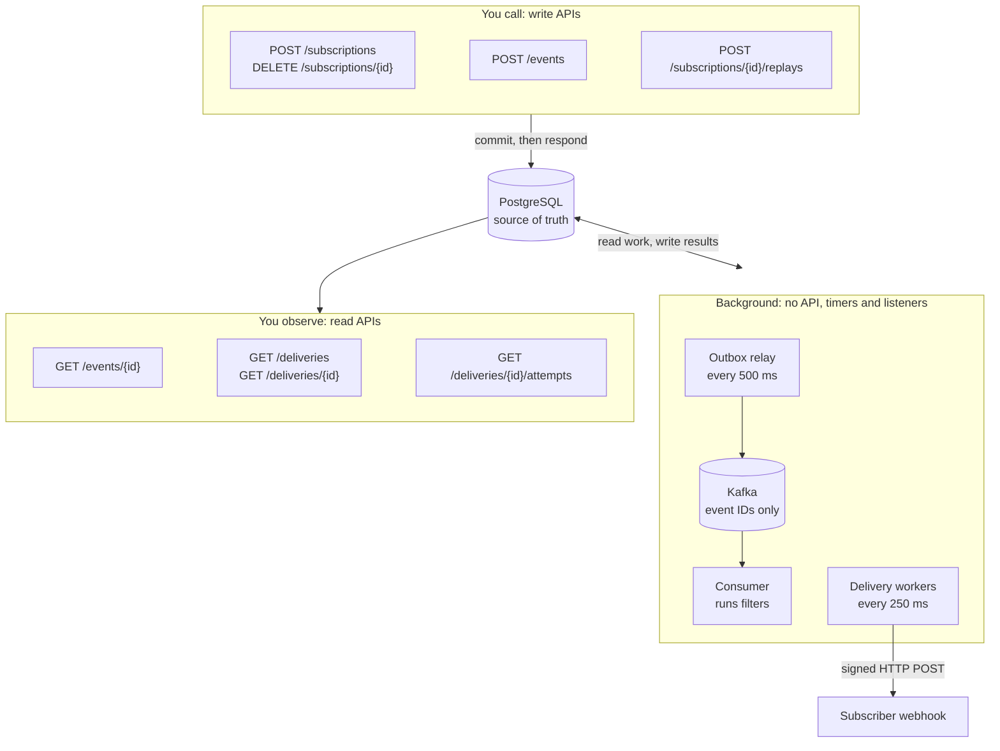
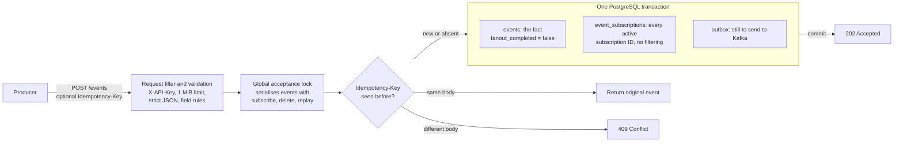
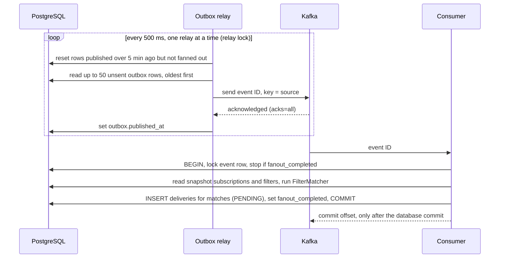
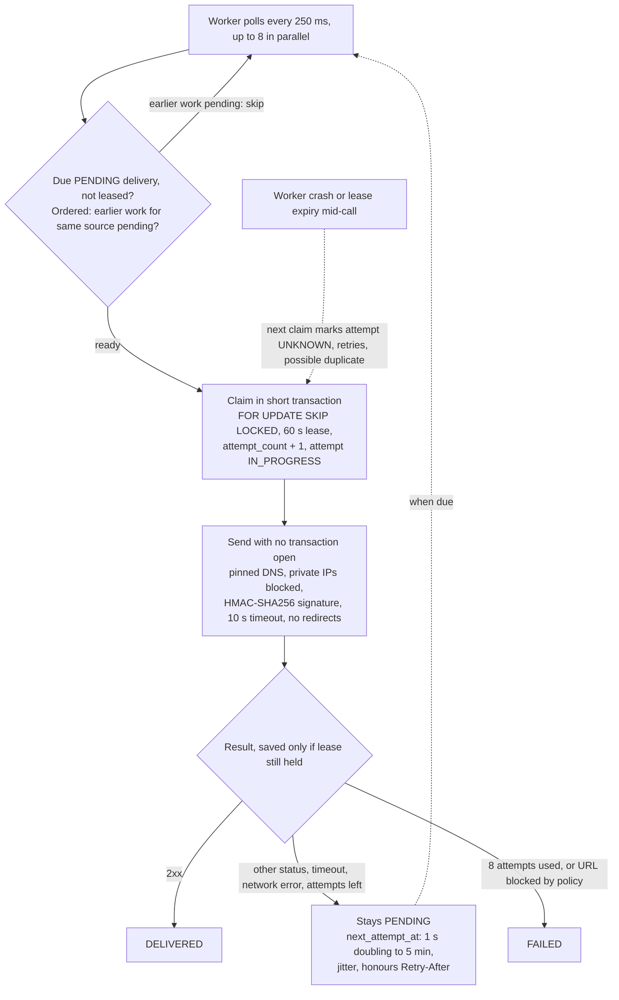
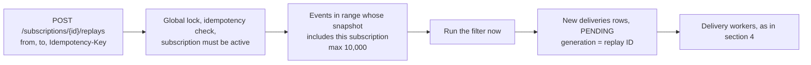

# Event-driven notification fanout

A Java 21 service that accepts JSON events, snapshots active subscriptions, routes events through Kafka, and sends signed webhook notifications. PostgreSQL is the source of truth for events, the transactional outbox, delivery state, and attempt history. Kafka is the asynchronous fanout backbone.

Implemented extensions: managed Kafka integration, opt-in per-source delivery ordering, an idempotent time-range replay API, and DigitalOcean App Platform deployment configuration.

| Start here | What it contains |
|---|---|
| [Postman collection](postman/Notification-Fanout-API.postman_collection.json) and [environment](postman/notification-fanout.postman_environment.json.json) | Importable requests and connection variables; follow [Test with Postman](#test-with-postman) below |
| [DigitalOcean testing guide](docs/DigitalOcean-testing-guide.md) | Step-by-step cloud checks, expected responses, failure scenarios, and assignment evidence |
| [DigitalOcean deployment guide](deploy/digitalocean/README.md) | Managed PostgreSQL/Kafka setup, runtime variables, networking, troubleshooting, and deployment workflow |
| [OpenAPI specification](docs/openapi.yaml) | Full API contract, also importable into Postman |

## Start locally

Requirements: Docker with Compose. Running outside Docker also requires JDK 21+; the Maven wrapper downloads Maven automatically.

**The complete application requires PostgreSQL and Kafka.** Compose creates both locally, so local testing needs no managed cloud clusters. There is no in-memory database/demo profile. App Platform builds the service's Dockerfile; it does not start the backing services in `compose.yaml`.

```sh
cp .env.example .env
# Edit .env and replace FANOUT_API_KEY with `openssl rand -hex 32` output.
docker compose up --build -d
docker compose logs -f app
```

The API listens on `http://localhost:8080`. PostgreSQL and Kafka have persistent Docker volumes. `docker compose down` preserves them; `docker compose down -v` destroys all local data.

To run Java directly:

```sh
docker compose up -d postgres kafka kafka-init
export FANOUT_API_KEY='replace-with-a-random-value-at-least-32-characters-long'
export DB_URL='jdbc:postgresql://localhost:5432/fanout'
export DB_USERNAME=fanout
export DB_PASSWORD=fanout-local-only
export KAFKA_BOOTSTRAP_SERVERS=localhost:9092
./mvnw spring-boot:run
```

If you changed `DB_PASSWORD` in `.env`, use the same value in the Java process. The shell does not automatically load `.env`.

The Compose defaults are for local development. Kafka is a single plaintext broker, and PostgreSQL has a development password. Production uses managed PostgreSQL and Kafka with verified TLS; see [DigitalOcean deployment](deploy/digitalocean/README.md).

## Test with Postman

### Import and configure

1. In Postman, select **Import** and import both the [collection](postman/Notification-Fanout-API.postman_collection.json) and [environment JSON](postman/notification-fanout.postman_environment.json.json). The environment filename currently ends in `.json.json`; import that file as supplied.
2. Select **digital-ocean-env** as the active environment. Duplicate it for local testing if needed.
3. Set the variables below. The shared export retains the app URL, but credentials, the receiver URL, and generated IDs are intentionally empty. Supply credentials in your private Postman environment.

| Variable | Where to get its value |
|---|---|
| `baseUrl` | DigitalOcean App Platform → your app → **Live App**, using its public HTTPS URL without a trailing `/`. For local Compose, use `http://localhost:8080`. Confirm the exported URL is the deployment you intend to test. |
| `apiKey` | The exact `FANOUT_API_KEY` configured on the running app. This is the service's administrator key, not a DigitalOcean access token, PostgreSQL password, or Kafka password. |
| `signingSecret` | A separate random secret of at least 32 characters, supplied when creating the subscription. Generate it with `openssl rand -hex 32`; your receiver uses it to verify signatures. |
| `webhookUrl` | A reachable public HTTPS receiver. For a smoke test, use **Your unique URL** from [Webhook.site](https://webhook.site/), not its dashboard URL, and send fictional data. |
| `subscriptionId` | Leave blank initially; copy `id` from the successful **POST subscription** response. |
| `eventId` | Leave blank initially; copy `id` from the successful **POST event** response. |
| `deliveryId` | Leave blank initially; copy the matching delivery object's `id` from the **GET deliveries** response array. |

`FANOUT_API_KEY` is configured on the server; Postman's `apiKey` only supplies that existing value. To create a new server key, generate at least 32 random characters, update the app's runtime secret, deploy the change, and set the same value in Postman. Keep the webhook signing secret separate.

API requests need `X-API-Key: {{apiKey}}`. For POST requests, select **Body → raw → JSON** and ensure `Content-Type: application/json` is present. Enter variable values without surrounding quotes. JSON bodies and Kafka's JAAS configuration have their own quotation syntax; do not remove the quotes inside those formats.

### Run the first end-to-end check

The bundled collection is a **manual smoke-test collection** with a replay request. It does not contain test assertions or scripts that automatically save IDs or wait for asynchronous delivery. Use request methods and paths to distinguish similarly named entries.

| Order | Request | Expected result / next action |
|---|---|---|
| 1 | `GET /actuator/health/readiness` (`health-check`) | `200` and `{"status":"UP"}`; no API key required |
| 2 | `POST /api/v1/subscriptions` (`subscriptions`) | `201`; save response `id` as `subscriptionId` |
| 3 | `POST /api/v1/events` (`events`) | `202`; save response `id` as `eventId` |
| 4 | `GET /api/v1/events/{{eventId}}` (`events`) | Eventually `fanoutCompleted: true` |
| 5 | `GET /api/v1/deliveries?eventId={{eventId}}&subscriptionId={{subscriptionId}}` (`delivery`) | Poll until the matching row exists; save its `id` as `deliveryId`, then verify `status: "DELIVERED"` |
| 6 | `GET /api/v1/deliveries/{{deliveryId}}/attempts` (`attempts`) | Check attempt timestamps, outcome, and a `2xx` `httpStatus`; confirm the same delivery arrived at the receiver |

Create the subscription **before** submitting the event. The sample subscription matches `order.created` from `checkout` with `payload.total >= 100`; the sample event uses `150`. Use a fresh `Idempotency-Key` for each new event/test run, replacing the collection's `cloud-demo-001`. Reusing an old key returns the original event, whose subscription snapshot may predate your new subscription. Reuse a key deliberately only when checking idempotency.

A readiness response verifies the process and database, not the complete Kafka/webhook path. `202` means durable acceptance; `fanoutCompleted` means matching finished. Confirm both `DELIVERED` and receiver receipt to complete the smoke test. Delivery lists can briefly be empty while matching runs.

For `replay`, update the example UTC dates to cover your events' `acceptedAt` timestamps, and choose a separate key such as `cloud-replay-001`. The original event ID is preserved; each replay delivery has a new delivery ID and a `replayId`.

Follow the [DigitalOcean testing guide](docs/DigitalOcean-testing-guide.md) for authentication failures, filtering, duplicate/conflicting ingestion, multiple subscribers, retry/recovery, terminal failure, ordering, replay, restart persistence, and deletion. It includes additional requests and receiver changes beyond the bundled collection. Save webhook/audit evidence and a green GitHub Actions run for the assignment.

### Common testing issues

| Symptom | Check |
|---|---|
| `401 A valid X-API-Key header is required` | Select the environment, populate `apiKey` with the running app's `FANOUT_API_KEY`, and enable the `X-API-Key` header. A Bearer token does not replace this header. |
| `415 Content-Type 'null' is not supported` | Use **Body → raw → JSON** and `Content-Type: application/json` for POST requests. |
| `404` at the app's root URL | There is no homepage; use `/actuator/health/readiness` or an API path. For an ID-based API URL, check that the variable contains an ID returned by this deployment. |
| Empty delivery array | Wait for fanout, check the filter and both IDs, and confirm the subscription existed before this event was accepted. Check Kafka connectivity if fanout never completes. |
| `PENDING` or `FAILED` delivery | Inspect attempts and `lastError`; check receiver availability, HTTP response codes, scheduled retries, and earlier ordered work. |

When sharing Postman files, export the collection and a sanitized environment copy. Keep real API keys and signing secrets out of exported JSON, saved examples, and Git. Clear receiver URLs and generated IDs for a fresh evaluator run; share any required test credential separately through an appropriate private channel.

## Architecture

PostgreSQL is the source of truth. Every stage reads rows left by the previous stage, does one job, and writes its result back. No stage calls another directly, so any stage can crash and resume from committed state. Kafka carries only event IDs, as a durable trigger between ingestion and matching.

### 1. Overview: what you call, what runs on its own, what you read



Replay writes delivery rows straight to PostgreSQL. It does not go through the outbox or Kafka; the delivery workers pick replayed work up like any other.

### 2. Ingestion: what each write API commits



| API | Lock | Rows written | Response |
|---|---|---|---|
| `POST /subscriptions` | Global | 1 row in `subscriptions`. The filter is validated and stored, not evaluated. | `201` |
| `POST /events` | Global | `events` + one `event_subscriptions` row per active subscription + `outbox` | `202` |
| `DELETE /subscriptions/{id}` | Global | Sets `subscriptions.deleted_at` (soft delete) | `204` |
| `POST /subscriptions/{id}/replays` | Global | `replays` + new `deliveries` rows (see section 5) | `202` |

- `202` is returned only after the commit. A database failure is an error response, never a false acceptance.
- **Why the snapshot:** filters run later, asynchronously, and subscriptions can be created or deleted in the meantime. `event_subscriptions` freezes who was listening when the event was accepted. Filters are immutable, so evaluating them later gives the same answer as evaluating them now.
- **Why the global lock:** without it, a subscription committed just before an event could be missing from that event's snapshot, or one deleted just before could still be included. Serialising these operations gives every event a clean before-or-after relationship with every subscription change. The cost is that acceptance is serialised.
- **Why an outbox:** the event and the instruction to publish it commit together, so a crash cannot leave an accepted event that Kafka never hears about, and Kafka downtime does not block ingestion.

### 3. Fanout: outbox relay, Kafka, and the consumer



- A crash after Kafka acknowledges but before `published_at` is set publishes the event again. The consumer ignores it because `fanout_completed` is already true, and the unique key `(event_id, subscription_id, generation)` prevents a duplicate delivery row.
- A crash in the consumer rolls back its transaction, so Kafka redelivers the message.
- The 5-minute reset recovers events whose Kafka message was lost or expired, using PostgreSQL as the record.
- Keying by source keeps each source's events on one partition, in order.

### 4. Delivery: claim, send, retry



- No database transaction is held during HTTP, so slow webhooks do not hold locks.
- Retries are timestamps in PostgreSQL, not sleeping threads, so they survive restarts and any replica can perform them.
- 4xx responses are retried like 5xx. Only an outbound-policy rejection fails immediately.
- Every attempt is written to `delivery_attempts` with start and finish times, HTTP status or error, and outcome (`IN_PROGRESS`, `DELIVERED`, `RETRY`, `FAILED`, `UNKNOWN`).

### 5. Observe, replay, and delete

| API | Reads | Use it to answer |
|---|---|---|
| `GET /events/{id}` | `events` | Has matching run yet? (`fanoutCompleted`) |
| `GET /deliveries?eventId=&subscriptionId=` | `deliveries` | Who matched, and what is each delivery's status? |
| `GET /deliveries/{id}` | `deliveries` | Current status of one delivery |
| `GET /deliveries/{id}/attempts` | `delivery_attempts` | The full try-by-try audit |
| `GET /subscriptions`, `GET /subscriptions/{id}` | `subscriptions` | Who is listening (the list hides deleted ones; by ID includes them) |



- Replay re-sends matching events even if they were delivered before. Each replay delivery has a new delivery ID and a `replayId`.
- For ordered subscriptions, replayed work queues behind all existing work.
- Deleting a subscription removes it from future snapshots and blocks new replays. Already accepted events keep their snapshot and pending deliveries, which still run. Nothing is retracted and audit history is kept.

## REST API

All `/api/v1/**` endpoints and protected observability endpoints require `X-API-Key`. This is an administrator API: the key grants access to all subscriptions and events. It is not a multi-tenant authorization system.

The complete request/response contract is available in [the OpenAPI specification](docs/openapi.yaml).

Request bodies are limited to 1 MiB by default, including chunked requests; compressed bodies are rejected. JSON is limited to 100 nesting levels, 100-character numeric tokens, and 1 MiB strings. Unknown DTO fields, duplicate keys, and trailing JSON tokens return `400`; oversized bodies return `413`. Payload objects, arrays, and scalar JSON values are supported within these limits.

```sh
export API=http://localhost:8080
export FANOUT_API_KEY='the-same-key-as-the-service'
```

| Method | Path | Purpose |
|---|---|---|
| `POST` | `/api/v1/subscriptions` | Create an immutable subscription, `201` |
| `GET` | `/api/v1/subscriptions` | List active subscriptions |
| `GET` | `/api/v1/subscriptions/{id}` | Inspect a subscription |
| `DELETE` | `/api/v1/subscriptions/{id}` | Soft-delete, `204` |
| `POST` | `/api/v1/events` | Durably accept an event, `202` |
| `GET` | `/api/v1/events/{id}` | Inspect event and fanout state |
| `GET` | `/api/v1/deliveries?eventId={id}` | Delivery history for an event |
| `GET` | `/api/v1/deliveries?subscriptionId={id}` | Delivery history for a subscription |
| `GET` | `/api/v1/deliveries/{id}` | Inspect one delivery |
| `GET` | `/api/v1/deliveries/{id}/attempts` | Timestamped attempt history |
| `POST` | `/api/v1/subscriptions/{id}/replays` | Schedule a time-range replay, `202` |
| `GET` | `/actuator/health` | Public health status |
| `GET` | `/actuator/health/liveness` | Process liveness |
| `GET` | `/actuator/health/readiness` | Readiness |
| `GET` | `/actuator/prometheus` | Authenticated Prometheus metrics |

List endpoints return JSON arrays and accept a bounded `limit` and an `after` cursor. For subscriptions and deliveries, pass the last item's numeric `sequence` as `after`; for attempts, pass its numeric `id`. UUID identifiers are not cursors. Delivery list filters can be combined. Audit entries contain attempt start/completion timestamps, the HTTP response status when received, and an error or outcome; an unknown network outcome has no fabricated HTTP status.

### Register a subscription

```sh
curl -i "$API/api/v1/subscriptions" \
  -H "X-API-Key: $FANOUT_API_KEY" \
  -H 'Content-Type: application/json' \
  -d '{
    "webhookUrl": "https://your-public-service.example/webhooks/orders",
    "signingSecret": "replace-this-with-a-random-32-byte-or-longer-secret",
    "ordered": true,
    "filter": {
      "eventTypes": ["order.created"],
      "sources": ["checkout"],
      "conditions": [
        {"path": "/total", "operator": "GTE", "value": 100},
        {"path": "/customer/country", "operator": "IN", "value": ["IN", "US"]}
      ]
    }
  }'
```

The URL must be HTTPS and resolve only to public addresses by default. For intentional local webhook testing, set `FANOUT_DELIVERY_ALLOW_HTTP=true` and `FANOUT_DELIVERY_ALLOW_PRIVATE_ADDRESSES=true`. Do not enable those exceptions for an internet-facing installation.

### Accept an event

```sh
curl -i "$API/api/v1/events" \
  -H "X-API-Key: $FANOUT_API_KEY" \
  -H 'Content-Type: application/json' \
  -H 'Idempotency-Key: order-1001-created' \
  -d '{"type":"order.created","source":"checkout","payload":{"orderId":"1001","total":149.99,"customer":{"country":"IN"}}}'
```

The same idempotency key and semantically equivalent request return the original event. Reusing a key with different content returns `409`. Keys are scoped to the operation, retained with the data, and limited to 128 characters. Without a key, repeated HTTP calls intentionally create distinct events. An HTTP timeout can mean the transaction committed; retry with the same key.

### Inspect delivery history

```sh
curl "$API/api/v1/deliveries?eventId=EVENT_UUID&limit=100" \
  -H "X-API-Key: $FANOUT_API_KEY"
curl "$API/api/v1/deliveries/DELIVERY_UUID/attempts" \
  -H "X-API-Key: $FANOUT_API_KEY"
```

Delivery status is `PENDING`, `DELIVERED`, or `FAILED`. Pending work may be waiting for its scheduled retry time, another earlier event, or an active lease. The attempt history distinguishes these from successful delivery; a `202` ingestion response is not a webhook receipt.

## Filter rule syntax

All top-level constraints and payload conditions are combined with **AND**. Entries inside `eventTypes` or `sources` use **OR**. An omitted or empty type/source list matches all values. An empty filter matches every event in the subscription snapshot. Matching is case-sensitive; there are no wildcards, regular expressions, executable expressions, or implicit string-to-number conversions.

`path` is an RFC 6901 JSON Pointer evaluated relative to `payload`: `/customer/id`, `/items/0/sku`, `/a~1b` for a property named `a/b`, and `/x~0y` for `x~y`.

| Operator | Value | Semantics |
|---|---|---|
| `EQ` | JSON value | Equality of an existing payload value |
| `NE` | JSON value | Inequality of an existing value; missing paths do not match |
| `EXISTS` | Boolean | `true` requires the path, `false` requires its absence |
| `IN` | JSON array | Existing value equals one entry |
| `GT`, `GTE`, `LT`, `LTE` | JSON number | Numeric comparison; nonnumeric or missing fields do not match |

Explicit JSON `null` is a present value and differs from a missing property. Empty conditions match. Invalid pointers/operators, incompatible operator values, malformed JSON, unknown fields, and oversized requests are rejected at the API boundary.

Numbers must also expand to at most 100 decimal characters, preventing tiny exponent tokens from expanding into oversized stored JSON. Storage validation rejects U+0000, unpaired Unicode surrogates, and numbers outside PostgreSQL numeric bounds with `400`, before persistence. These are [PostgreSQL JSONB representation limits](https://www.postgresql.org/docs/17/datatype-json.html).

## Webhook contract and receiver responsibilities

The body is a JSON envelope containing the original event ID, type, source, payload, acceptance time, ingestion sequence (`eventSequence`), delivery ID, subscription ID, and replay ID when applicable. The same delivery keeps the same `X-Delivery-Id` on every retry. A replay is a new delivery with a new delivery ID and the original event ID.

Headers:

- `X-Event-Id`: original event identifier.
- `X-Delivery-Id`: delivery identifier; use this as the idempotency key at the receiver.
- `X-Delivery-Attempt`: attempt number.
- `X-Webhook-Timestamp`: current Unix timestamp in seconds.
- `X-Webhook-Signature`: `v1=` followed by hexadecimal HMAC-SHA256.

The signed bytes are `timestamp + "." + exact HTTP request body bytes`, using the subscription signing secret. Verify signatures with constant-time comparison and a limited timestamp tolerance; do not parse and reserialize the body before verification. Store the delivery ID atomically with your business side effect and return `2xx` only after durable acceptance. Signature timestamps can change on retry.

Redirects are not followed. Destination addresses are checked and pinned for each attempt to reduce SSRF and DNS rebinding exposure. Connection and response deadlines bound network work. Response bodies are not retained in the audit store, avoiding unbounded storage and accidental collection of subscriber data.

## Delivery guarantees and failure conditions

This is **at-least-once delivery with a finite retry policy**, not exactly once. More precisely, accepted matching events produce durable delivery work; attempts continue until an acknowledged `2xx`, a destination-policy rejection, or the configured attempt limit. There is no promise that an unreachable subscriber will eventually receive a notification. Exhausted work remains visibly `FAILED` and can be replayed.

| Failure | Behavior |
|---|---|
| Database unavailable during ingest | Request fails; no successful acceptance is returned |
| Process crashes after commit but before producer receives `202` | Event remains durable; producer retry with the same key returns the original |
| Kafka unavailable | Accepted events remain in the PostgreSQL outbox; publication resumes after recovery |
| Kafka expires or loses a published record before fanout | The relay republishes unprocessed events after five minutes from retained PostgreSQL data |
| Relay crashes after broker acknowledgment | Duplicate Kafka publication is possible; fanout is idempotent |
| Consumer crashes before fanout commit | Kafka record is processed again |
| Consumer crashes after fanout commit, before offset commit | Record repeats; uniqueness and transaction state prevent duplicate original deliveries |
| Worker crashes after subscriber accepts, before success is recorded | Lease expires and another attempt is made; subscriber can receive a duplicate |
| Timeout / connection failure / any non-`2xx`, including redirects | Retry with capped exponential backoff and jitter, until the attempt limit; `Retry-After` is bounded by the maximum backoff |
| Destination violates URL/address policy | Terminal `FAILED`; inspect configuration and use replay after remediation |
| Subscriber processes a request but returns an error | A retry can repeat the side effect unless the receiver deduplicates |
| PostgreSQL loses committed data, backups are unavailable, or an operator deletes data | Durability cannot be recovered by this application alone |

Default delivery settings: 8 attempts, 1 second initial backoff, 5 minute maximum backoff, 10 second request timeout, 60 second lease, and 8 concurrent sends. Configure these with `fanout.delivery.*` Spring properties; keep leases longer than the complete network timeout budget. Retry exhaustion is an explicit terminal state, never a silent drop.

### Per-source ordering

Set `ordered=true` on a subscription to serialize dispatch for each `(subscription, source)` stream. A later event waits behind earlier nonterminal matching work, including earlier events still awaiting fanout. Different sources and subscriptions can progress independently. Ordering uses durable ingestion sequence, not producer clocks or timestamps supplied in the payload.

An exhausted/policy-failed delivery is terminal and releases subsequent work; ordering is therefore not gapless successful delivery. Network timeouts and process crashes create ambiguous remote outcomes: an earlier request might complete at the receiver after its lease expires. Receivers must still deduplicate, and absolute remote completion order cannot be guaranteed by an HTTP sender alone. Replays are appended to the current queue, with original event sequence preserved within the replay; they intentionally revisit historical events rather than restoring the original timeline.

### Replay after an outage

```sh
curl -i "$API/api/v1/subscriptions/SUBSCRIPTION_UUID/replays" \
  -H "X-API-Key: $FANOUT_API_KEY" \
  -H 'Content-Type: application/json' \
  -H 'Idempotency-Key: recovery-2026-11-01' \
  -d '{"from":"2026-11-01T00:00:00Z","to":"2026-11-02T00:00:00Z"}'
```

Ranges are UTC instants with inclusive `from` and exclusive `to`, based on server acceptance time. A range may span at most 31 days and select at most 10,000 eligible events. Split larger recovery windows. Replay reevaluates the target subscription's immutable filter against retained events for which that subscription was present in the original ingestion snapshot. It does not expose events accepted before registration. The target must be active. Repeating the same key and range returns the existing replay; different content with the same key conflicts. Original audit history is preserved.

## Deploy on DigitalOcean

Follow the [deployment guide](deploy/digitalocean/README.md) for the complete UI steps, environment-variable table, and troubleshooting. The [App Platform spec](deploy/digitalocean/app.yaml) is a template: replace its placeholders before use.

1. Provision managed PostgreSQL and Kafka in the intended region/VPC. Create the database/user and the Kafka topic `fanout.events.v1`; the application does not create Kafka topics.
2. Connect the GitHub repository to App Platform using its Dockerfile, HTTP port `8080`, and readiness path `/actuator/health/readiness`.
3. Set `SPRING_PROFILES_ACTIVE=cloud`, the database and Kafka connection variables/certificates, and a generated `FANOUT_API_KEY`. For private Kafka access, copy **both hostname and port from VPC network → SASL**; a private hostname with the public SASL port can fail when the client connects to the advertised brokers.
4. Enable the app's VPC connection and authorize its outbound connection on **both** managed clusters. Size database pools for the total app instance count; public ingress IPs are not the app's outbound IPs.
5. Deploy, inspect runtime logs, and run the [cloud testing guide](docs/DigitalOcean-testing-guide.md). A successful image build alone does not verify startup or end-to-end delivery.

## Automated tests and CI/CD

```sh
./mvnw test        # Unit tests; does not require Docker
./mvnw verify      # Unit + integration tests; requires a working Docker daemon
```

Integration tests use **real PostgreSQL and Kafka** in Testcontainers and a local HTTP receiver. They must run rather than silently skip when Docker is missing. Unit tests cover filter semantics, URL policy, signature generation, and retry behavior. Integration tests exercise HTTP authentication and validation, concurrent idempotent ingestion, matching/nonmatching fanout, retries and audit history, terminal failure, deletion, replay, ordering, duplicate Kafka records, a paused-broker outage, transaction rollback on outbox failure, and lease recovery/fencing. See the test sources for executable scenarios and precise assertions.

| Workflow | Trigger | What it verifies or deploys |
|---|---|---|
| [Build and test](.github/workflows/ci.yml) | Every push, pull request, or manual run | JDK 21, `sh ./mvnw -B -ntp verify`, uploaded test/coverage reports, then a Docker image build |
| [Deploy to DigitalOcean](.github/workflows/deploy.yml) | Manual run on `main`, with an existing `app_id` | Reruns `verify`, then requests an App Platform rebuild/deployment and waits for completion |

**CI runs in GitHub Actions, not in the DigitalOcean window.** Push the repository including `.github/workflows/ci.yml`, open **GitHub → Actions → Build and test**, and check the run for that commit. Testcontainers starts disposable PostgreSQL and Kafka on the GitHub runner; CI needs neither managed-cluster credentials nor a DigitalOcean token. Reports are attached as the `test-reports` artifact. The Postman collection and cloud guide are separate manual acceptance checks.

To enable the deployment workflow, create the GitHub environment `production`, add its `DIGITALOCEAN_ACCESS_TOKEN` secret, and run **Deploy to DigitalOcean** with the App Platform app ID. Disable App Platform's automatic deploy-on-push when using this test-gated workflow; an independent automatic deployment does not wait for GitHub CI. The supplied app spec already disables it. See the [deployment workflow instructions](deploy/digitalocean/README.md#github-actions-ci-and-deployment).

If a run exits immediately with `./mvnw: Permission denied` (exit code `126`), Maven and the tests have not started: the wrapper's executable permission is missing. Both workflows invoke it with `sh ./mvnw` so they also work after file uploads/exports that lose permissions. For direct local execution, run `chmod +x mvnw`; in a Git checkout, record the executable bit with `git update-index --chmod=+x mvnw`. Push the updated workflow files to trigger a new run; rerunning an old failed commit does not pick up the fix.

The deployment workflow rebuilds the app's configured remote `main` branch; it does not promote the image built by CI. Avoid concurrent pushes during deployment. Promoting an immutable tested image digest is a future hardening step.

## Operations

- Monitor ingestion error rate, unpublished outbox age/count, Kafka consumer lag, pending delivery age, retry rate, terminal failure count, HTTP latency, database pool saturation, and disk usage. A healthy process alone does not prove subscribers are receiving notifications.
- Alert on growing oldest pending/outbox age and newly failed deliveries. Consult attempt history to distinguish subscriber HTTP failures from transport errors and interrupted attempts.
- Protect and back up PostgreSQL with point-in-time recovery. Kafka retention must cover expected consumer downtime. PostgreSQL events/outbox remain the recovery source; do not delete them casually.
- Keep signing secrets and the API key out of logs, source control, and URLs. Use managed runtime secrets. Backups contain sensitive event payloads and signing material.
- Stop gracefully to allow running HTTP attempts to complete. On abrupt termination, leases expire and interrupted work is eligible for recovery.
- Use a reverse proxy or cloud ingress for HTTPS, request-rate limits, and request-size limits. Keep metrics accessible only to authenticated internal monitoring.

## What we sacrifice for simplicity vs. what we would harden next

| Current choice | Consequence | Next hardening step |
|---|---|---|
| One service owns API, relay, matcher, workers | Straightforward deployment; shared resource budget | Separate worker roles and autoscale using backlog age |
| PostgreSQL stores event bodies and per-event subscription snapshots | Clear deterministic subscription semantics; storage grows with event/subscription volume | Partition/archive history, explicit retention contracts, indexed routing, and staged fanout for very large subscriber populations |
| One serialized relay publication path | Simple ordering/recovery; limits publish throughput | Partitioned outbox ownership with per-source ordering and measured load tests |
| One administrator API key | Small authentication surface; no subscriber isolation | OIDC, tenant-scoped authorization, quotas, key rotation, audit of administrative changes |
| Signing secrets stored with subscriptions | Reliable retry and replay signing; database readers can access secrets | KMS envelope encryption and secret rotation with versioned signatures |
| Immutable subscriptions and soft deletion | Stable ingestion snapshots | Versioned updates, explicit cancellation semantics, retention-aware tombstone cleanup |
| Bounded retries and terminal failure | Predictable resource use; a long outage needs replay | Automated dead-letter workflows, operator redrive controls, per-subscriber circuit breakers and rate budgets |
| Basic JSON Pointer filters | Predictable, safe matching cost | A constrained validated DSL only if actual product requirements need it |
| Application-level URL checks | Defense against common SSRF targets | Egress proxy/firewall allowlists, DNS controls, and tenant-specific destination policies |
| No automatic audit/event deletion | Complete retained replay and audit history; unbounded growth | Time partitioning, retention jobs, payload minimization, archive/replay policy, restore drills |
| Local Compose uses one broker/database | Easy evaluation; no infrastructure high availability | Managed HA services, replication factor 3, `min.insync.replicas=2`, backups, chaos/load testing, and documented SLOs |

This repository provides production-oriented mechanisms and runnable verification. Capacity limits, backup restore behavior, managed-service connectivity, and deployment-specific security controls still require validation in the intended production environment.
